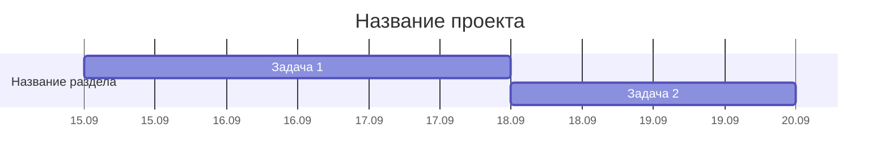
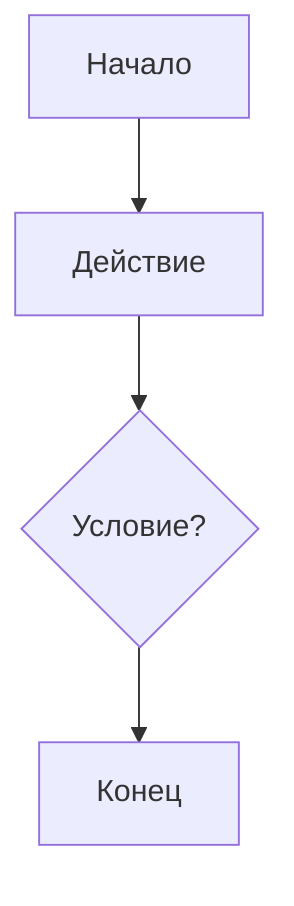
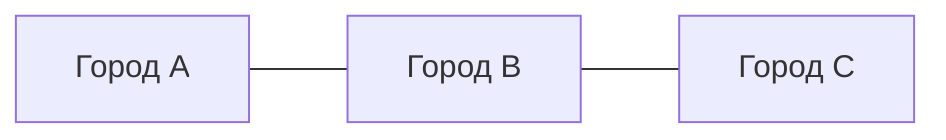
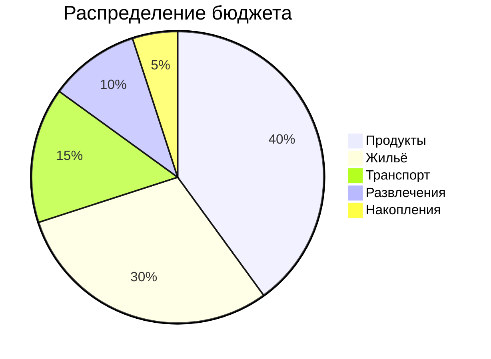
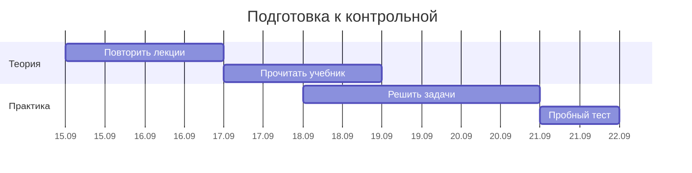
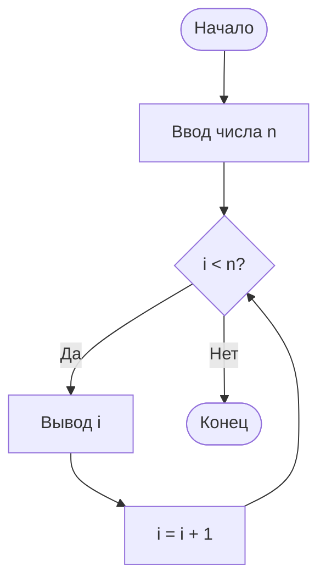
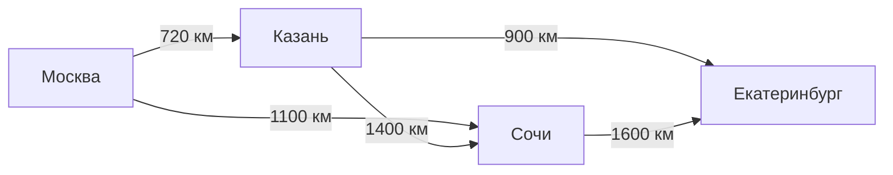

# 📚 Урок: Визуализация данных в Markdown с помощью Mermaid
**10 класс (углублённый уровень) | 40 минут | StackEdit.io**

---

## 🎯 Цели урока
- Научиться создавать круговые диаграммы, диаграммы Ганта и графы.
- Понимать области применения каждого типа визуализации.
- Развивать навыки проектного планирования и моделирования данных.

---

## ⏱️ Структура урока

| Этап | Время | Содержание |
|------|-------|------------|
| 1. Оргмомент + теория | 5 мин | Введение, что такое Mermaid и как он работает в StackEdit |
| 2. Круговая диаграмма | 7 мин | Пример + практическая задача |
| 3. Диаграмма Ганта | 10 мин | Пример + практическая задача |
| 4. Графы | 13 мин | Пример + практическая задача |
| 5. Итоги + Д/З | 5 мин | Рефлексия, домашнее задание |

---

## 📖 КОНСПЕКТ (теория для учеников)

### 1. Круговая диаграмма (`pie`)
**Назначение:** Показывает доли частей от целого (проценты, пропорции).

**Синтаксис:**


**Важно:**
- Mermaid сам пересчитывает числа в проценты.
- Используйте короткие названия категорий (1–2 слова).
- Длинные подписи выносите в обычную Markdown-таблицу или список под диаграммой.

---

### 2. Диаграмма Ганта (`gantt`)
**Назначение:** Планирование проектов, отображение задач и их длительности во времени.

**Синтаксис:**


**Ключевые элементы:**
- `dateFormat YYYY-MM-DD` — строгий формат ввода дат (обязательно!).
- `axisFormat %d.%m` — компактное отображение дней на оси (например, 15.09), чтобы даты не налезали друг на друга.
- `3d` — длительность 3 дня (также можно `1d`, `5d`, `1w`).
- `after a1` — задача начнётся сразу после завершения задачи с идентификатором `a1`.
- `section` — группировка задач по смысловым разделам.

---

### 3. Графы (`graph`)
**Назначение:** Моделирование связей, алгоритмов, сетей, структур данных.

**а) Направленный граф (со стрелками):**


**б) Ненаправленный граф (линии без стрелок):**


**в) Взвешенный граф (с подписями на рёбрах):**


**Обозначения:**
- `graph TD` — направление сверху вниз (Top-Down).
- `graph LR` — направление слева направо (Left-Right).
- `A[...]` — прямоугольник.
- `A(...)` — овал.
- `A{...}` — ромб (условие).
- `-->` — направленное ребро.
- `---` — ненаправленное ребро.
- `-- "текст" -->` — ребро с текстовой подписью (весом).

---

## 💻 ПРИМЕРЫ (демонстрирует учитель)

### Пример 1: Круговая диаграмма


### Пример 2: Диаграмма Ганта


### Пример 3: Направленный граф (алгоритм)


### Пример 4: Взвешенный граф (сеть городов)


---

## 🧪 ПРАКТИЧЕСКИЕ ЗАДАЧИ (выполняют ученики)

### Задача 1. Круговая диаграмма (7 минут)
**Задание:** Постройте круговую диаграмму «Моё время в будний день»:
- Школа — 7 часов
- Домашнее задание — 3 часа
- Сон — 8 часов
- Хобби/отдых — 4 часа
- Прочее — 2 часа

**Требования:**
- Используйте короткие названия (1–2 слова).
- Под диаграммой создайте Markdown-таблицу с полной расшифровкой и рассчитанными процентами.

---

### Задача 2. Диаграмма Ганта (10 минут)
**Задание:** Спланируйте подготовку к школьному проекту на 1 неделю (7 дней).

**Требования:**
- Минимум 4 задачи.
- 2 раздела (`section`): «Подготовка» и «Реализация».
- Используйте ключевое слово `after` для связывания зависимых задач.
- Отображайте даты на оси в компактном формате `%d.%m`.
- Начальная дата: любой понедельник сентября 2025 года.

---

### Задача 3. Графы (13 минут)

**Часть А. Направленный граф (5 минут)**
Постройте блок-схему алгоритма «Поиск максимального числа из трёх (a, b, c)»:
- Начало
- Ввод a, b, c
- Условие: a > b? (ветвление)
- Промежуточное присваивание max
- Условие: max > c? (ветвление)
- Вывод max
- Конец

**Часть Б. Взвешенный граф (8 минут)**
Постройте граф маршрутов между 5 городами России с указанием расстояний (в км). 
**Требования:**
- Горизонтальное расположение (`graph LR`).
- Подписи на рёбрах с расстояниями.
- Минимум 6 соединений (рёбер).
- *Пример городов:* Москва, Санкт-Петербург, Казань, Новосибирск, Владивосток.

---

## ✅ КРИТЕРИИ ОЦЕНИВАНИЯ

| Критерий | Баллы |
|----------|-------|
| **Задача 1 (pie)** | |
| Корректный синтаксис диаграммы | 2 |
| Наличие таблицы с расшифровкой под ней | 1 |
| **Задача 2 (gantt)** | |
| Наличие 4+ задач и 2 разделов (`section`) | 2 |
| Корректное использование `after` | 1 |
| Корректный формат дат (`axisFormat %d.%m`) | 1 |
| **Задача 3 (graph)** | |
| Направленный граф (логика алгоритма верна) | 2 |
| Взвешенный граф (6 и более рёбер) | 2 |
| Наличие подписей расстояний на рёбрах | 1 |
| **ИТОГО** | **12** |

**Шкала оценок:**
- 11–12 баллов = «5»
- 8–10 баллов = «4»
- 6–7 баллов = «3»

---

## 📝 ДОМАШНЕЕ ЗАДАНИЕ

**Выберите ОДНО из заданий на выбор:**

- **Вариант А (для аналитиков):** Создайте ER-диаграмму (`erDiagram`) для школьной библиотеки (сущности: Книга, Читатель, Выдача, их атрибуты и связи).
- **Вариант Б (для программистов):** Постройте диаграмму последовательности (`sequenceDiagram`) процесса авторизации пользователя на сайте.
- **Вариант В (для проект-менеджеров):** Создайте расширенную диаграмму Ганта для подготовки к ЕГЭ (3 месяца, 4 предмета, вехи/milestone).

**Срок сдачи:** следующий урок.

---

## 🔗 ПОЛЕЗНЫЕ ССЫЛКИ

- [Mermaid Live Editor](https://mermaid.live) — онлайн-песочница для проверки синтаксиса.
- [Официальная документация Mermaid](https://mermaid.js.org/) — полный справочник.
- [StackEdit.io](https://stackedit.io) — наш основной редактор для работы.

---

## 💡 ПАМЯТКА УЧИТЕЛЮ

1. **Перед уроком:** Откройте StackEdit.io в браузере и проверьте, что все 4 примера из конспекта корректно отрисовываются.
2. **Во время урока:** 
   - Попросите учеников расположить окна так, чтобы код был слева, а предпросмотр (Preview) — справа.
   - Если диаграмма не отображается, первое, что нужно проверить: наличие открывающих ```mermaid и закрывающих ```.
3. **Типичные ошибки учеников:**
   - Забыли указать `dateFormat` в Gantt → диаграмма не рендерится.
   - Слишком длинные названия в `pie` → обрезаются краями холста (решение: сокращать название в коде, давать расшифровку в Markdown-таблице ниже).
   - Перепутали `-->` и `---` → получается не то направление связи.