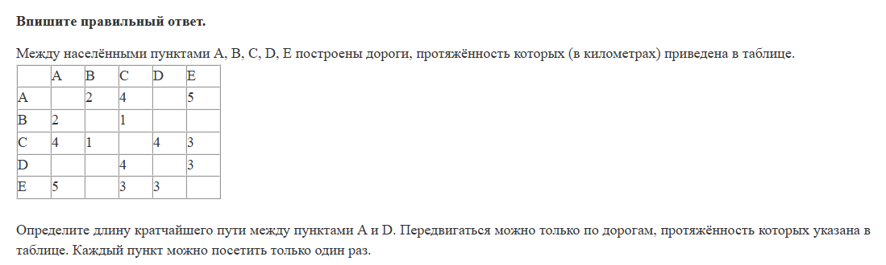
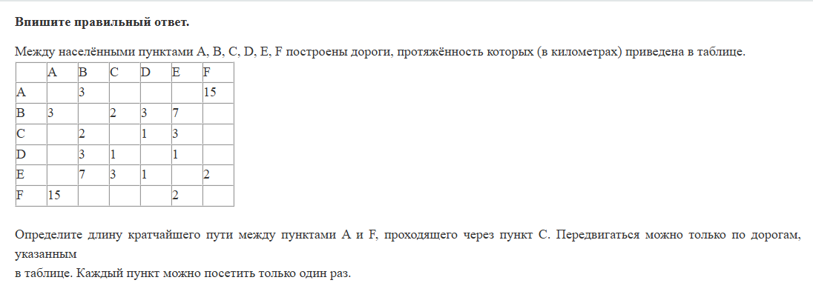
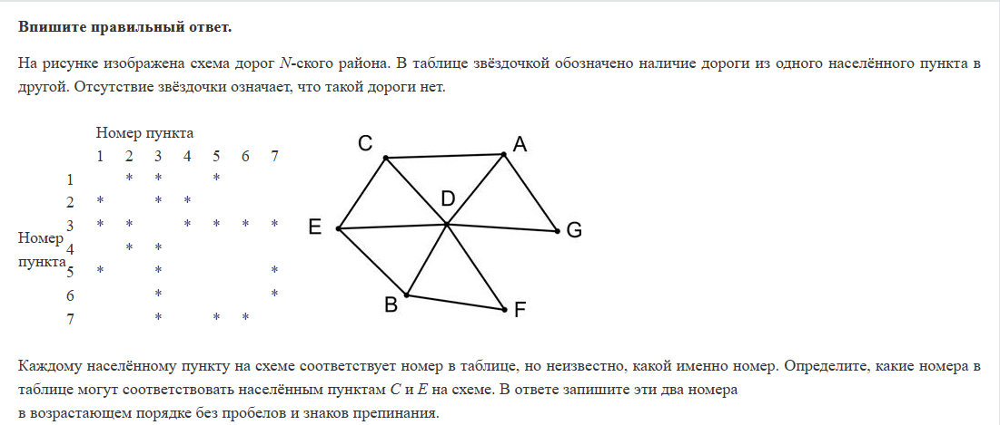
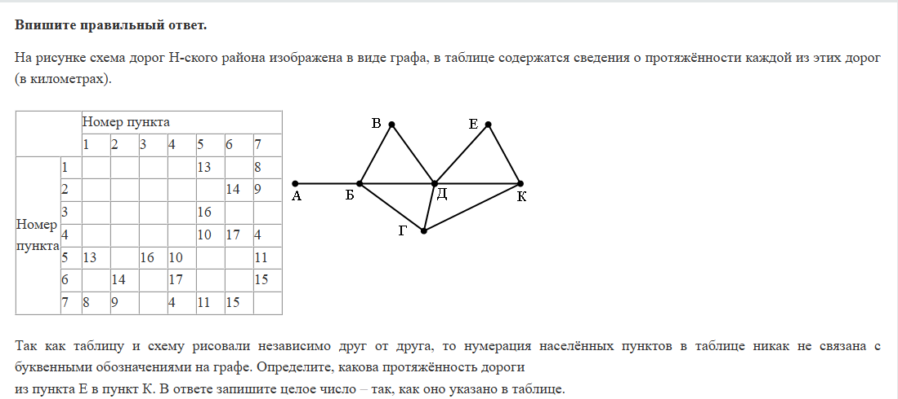
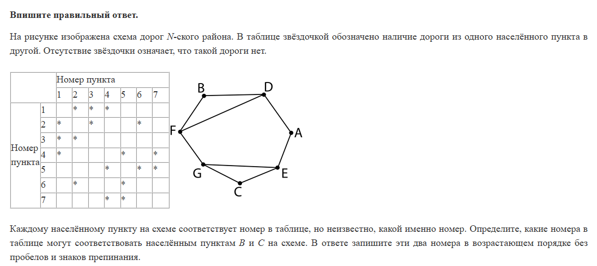
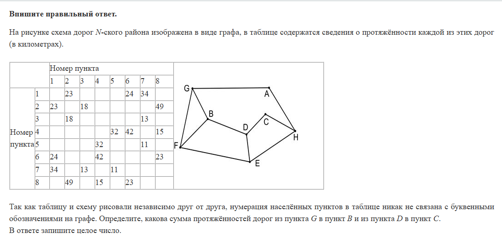
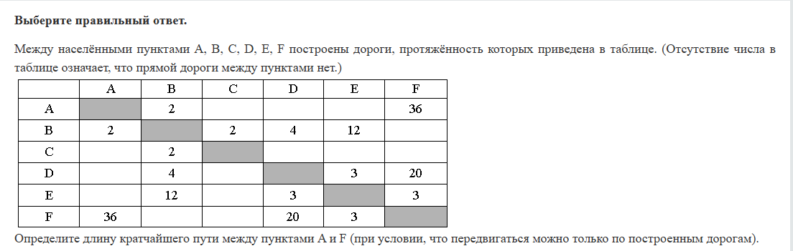
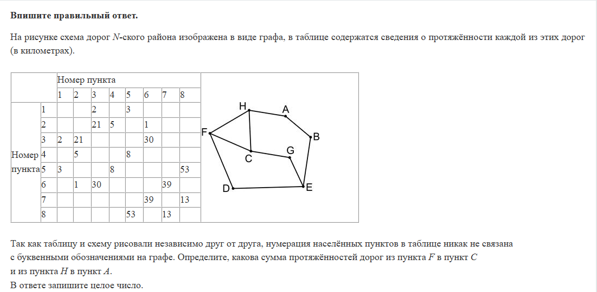
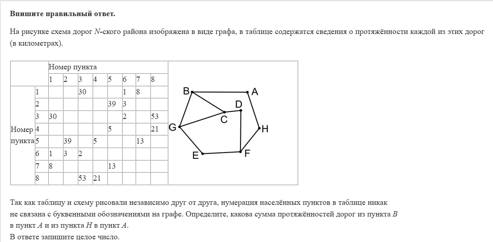

# Задание 1. Графы (задачи ЕГЭ с комментариями учителя)

Чистый алгоритм Дейкстры

Дейкстра с промежуточной точкой. Сначала идем до точки кратчайшим путем, потом от точки до финиша.

Задача без чисел. Такое тоже бывает.

Стандартная задача с однозначным ключом

Тоже стандартная задача. Жаба прячется в ответе.

Тоже стандарт, про сумму, когда точное знание какая вершина как обозначается в таблице – не нужно.

Еще раз простой Дейкстра

Приятный стандарт, хотя и кажется чуть диким

И еще один стандарт про сумму

