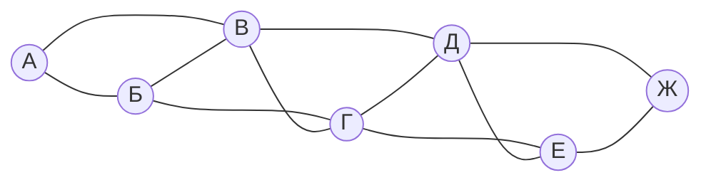
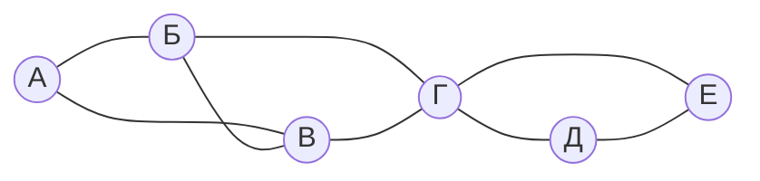
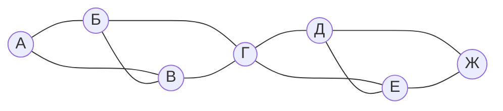

# ЕГЭ Информатика: Задание №1 — Графы и Таблицы (сложный уровень)

---

## Задание 1.1

На рисунке изображена схема дорог N-ского района в виде графа, в таблице содержатся сведения о длинах этих дорог (в километрах).

|    | П1 | П2 | П3 | П4 | П5 | П6 | П7 |
|----|----|----|----|----|----|----|----|
| П1 | —  | 7  | 14 | —  | —  | —  | —  |
| П2 | 7  | —  | 9  | 22 | —  | —  | —  |
| П3 | 14 | 9  | —  | 11 | 18 | —  | —  |
| П4 | —  | 22 | 11 | —  | 16 | 13 | —  |
| П5 | —  | —  | 18 | 16 | —  | 10 | 25 |
| П6 | —  | —  | —  | 13 | 10 | —  | 8  |
| П7 | —  | —  | —  | —  | 25 | 8  | —  |

Так как таблицу и схему рисовали независимо друг от друга, нумерация населённых пунктов в таблице никак не связана с буквенными обозначениями на графе.

**Определите, какой номер в таблице соответствует вершине Г на графе.**

---

## Задание 1.2

На рисунке изображена схема дорог N-ского района в виде графа, в таблице содержатся сведения о длинах этих дорог (в километрах).

|    | П1 | П2 | П3 | П4 | П5 | П6 |
|----|----|----|----|----|----|----|
| П1 | —  | 13 | 27 | —  | —  | —  |
| П2 | 13 | —  | 19 | 34 | —  | —  |
| П3 | 27 | 19 | —  | 41 | —  | —  |
| П4 | —  | 34 | 41 | —  | 22 | 28 |
| П5 | —  | —  | —  | 22 | —  | 15 |
| П6 | —  | —  | —  | 28 | 15 | —  |

Так как таблицу и схему рисовали независимо друг от друга, нумерация населённых пунктов в таблице никак не связана с буквенными обозначениями на графе.

**Определите, какие два номера в таблице могут соответствовать вершинам Д и Е на графе. В ответе запишите эти номера в порядке возрастания без разделителей.**

---

## Задание 1.3

На рисунке изображена схема дорог N-ского района в виде графа, в таблице содержатся сведения о длинах этих дорог (в километрах).

|    | П1 | П2 | П3 | П4 | П5 | П6 | П7 |
|----|----|----|----|----|----|----|----|
| П1 | —  | 12 | 18 | —  | —  | —  | —  |
| П2 | 12 | —  | 25 | 30 | —  | —  | —  |
| П3 | 18 | 25 | —  | 30 | —  | —  | —  |
| П4 | —  | 30 | 30 | —  | 15 | 22 | —  |
| П5 | —  | —  | —  | 15 | —  | 28 | 35 |
| П6 | —  | —  | —  | 22 | 28 | —  | 19 |
| П7 | —  | —  | —  | —  | 35 | 19 | —  |

Так как таблицу и схему рисовали независимо друг от друга, нумерация населённых пунктов в таблице никак не связана с буквенными обозначениями на графе.

**Определите длину дороги между вершинами Б и В на графе.**

---

## Задание 1.4

В таблице содержатся сведения о длинах дорог между населёнными пунктами П1, П2, П3, П4, П5, П6, П7, П8 (в километрах).

|    | П1 | П2 | П3 | П4 | П5 | П6 | П7 | П8 |
|----|----|----|----|----|----|----|----|----|
| П1 | —  | 15 | 28 | —  | —  | 42 | —  | —  |
| П2 | 15 | —  | 12 | 35 | —  | —  | —  | —  |
| П3 | 28 | 12 | —  | 18 | 24 | —  | —  | —  |
| П4 | —  | 35 | 18 | —  | 14 | 22 | —  | —  |
| П5 | —  | —  | 24 | 14 | —  | 11 | 38 | —  |
| П6 | 42 | —  | —  | 22 | 11 | —  | 16 | 29 |
| П7 | —  | —  | —  | —  | 38 | 16 | —  | 13 |
| П8 | —  | —  | —  | —  | —  | 29 | 13 | —  |

**Определите длину кратчайшего пути между пунктами П1 и П8, если передвигаться можно только по указанным дорогам.**