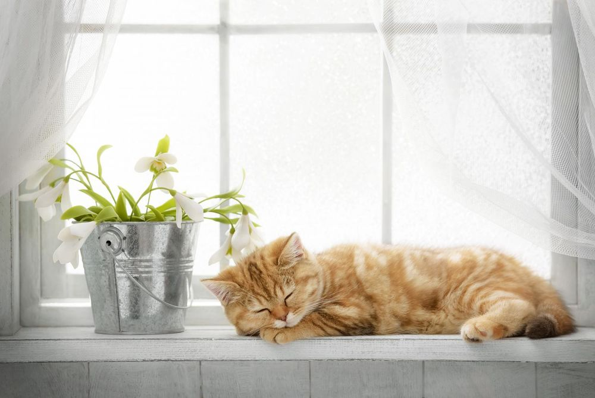
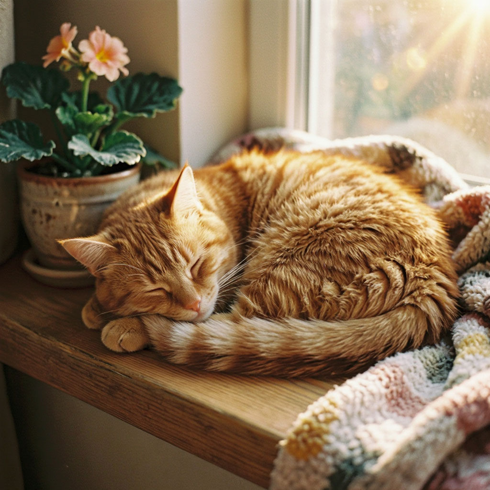
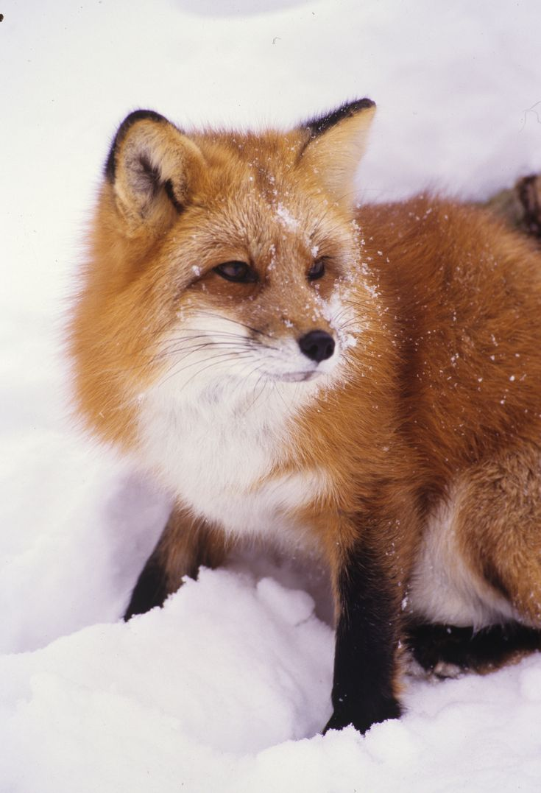
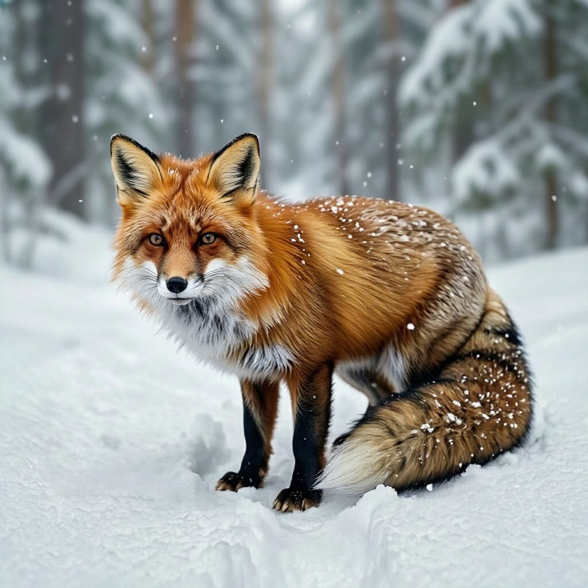

# Умный помощник в творчестве — презентация

Перенесено из PowerPoint (`prezentaciya_urok_IIK.pptx`, оригинал — в истории git). Картинки — в `slajdy-img/`.

## Слайд 1

Умный помощник в творчестве

ИИ и мультипликация

Информатика · ИИ · информационная безопасность

4 класс · 40 минут · 8 учеников

## Слайд 2

Критерии успеха

1. Есть персонаж

2. Он двигается

3. Могу объяснить, как сделал

## Слайд 3

Настоящее или ИИ?

Посмотрите на две пары картинок. Где настоящее фото, а где нарисовал ИИ?

Поднимите руку, кто угадал!

## Слайд 4

Три правила безопасности

Оживляем только персонажей, не фото людей

В чат не пишем фамилию, школу, адрес

Если ИИ выдал странное — зовём учителя

## Слайд 5

ИИ-анимация — что это?

Леся Гусева — ожившие картины

▶ Нажмите, чтобы посмотреть видео (~30 сек)

Что произошло с картинами? ИИ научился двигать то, что нарисовано.

Художник нарисовал — ИИ оживил. Кто здесь автор?

## Слайд 6

Леся Гусева — «Простоквашино» в реальности

Иллюстратор, которая теперь оживляет картины нейросетью

▶ Нажмите, чтобы посмотреть видео (~30 сек)

Дядя Фёдор, Матроскин, Шарик и Печкин — как будто настоящие.

Но их не было. Этого не было — это сделала нейросеть.

## Слайд 7

Метро «Площадь Революции»

▶ Нажмите, чтобы посмотреть видео (~34 сек)

Бронзовые фигуры ожили!

Но помните правило: этого не было — это сделала нейросеть.

Кстати: ИИ-искусство есть даже на выставке в Венеции (Италия).

## Слайд 8

Формула промпта

Объект

Кто?

Кот

Действие

Что делает?

прыгает

Среда

Где?

в лесу

Стиль

Как нарисовано?

как в мультике

Пример: Кот + прыгает + в лесу + как в мультике

## Слайд 9

Банк слов (действия)

машет

улыбается

танцует

смотрит

крутится

прыгает

летит

бежит

смеётся

кивает

## Слайд 10

Динамическая пауза

Встали! Я называю действие — вы показываете телом.Машет!  Прыгает!  Крутится!  Кивает!Садитесь. Ровные спинки, руки на клавиатуру.

## Слайд 11

Придумай персонажа

Заполни четыре строчки в шаблоне ручкой:

Кто? (объект)

(напр. робот, дракон, кот)

Где? (среда)

(напр. в космосе, в лесу, на кухне)

Что делает? (действие)

(напр. танцует, машет, летит)

Какой стиль?

(напр. как в мультике, акварель, 3D)

Правило: не себя, не одноклассника, не фото людей!

## Слайд 12

Инструкция

1. Напиши в чате Алисы: «Нарисуй…» + свой шаблон

2. Сохрани картинку в папку «Мой мультфильм»

3. Открой «Оживить фото», загрузи картинку, опиши действие

4. Сохрани видео в папку «Мой мультфильм»

— — — — — — — — — — — — — —

Не получилось? Возьми готовую картинку из папки «Заготовки»

## Слайд 13

Оживление персонажа

Загружаем картинку в «Оживить фото». Пишем, что персонаж должен делать.

Пауза для глаз (~30 сек, пока ИИ генерирует):

Зажмурились — открылиПосмотрели на дальнюю стену — на свой экран

## Слайд 14

Эксперименты

Сделал первый вариант?Попробуй второй —измени одно слово в промптеСтань «тихим помощником»соседу — но не делай за него!

Не успел с генерацией?Нарисуй персонажа на листе →сфотографируй →оживи фотоТогда автора видноособенно хорошо!

## Слайд 15

Фестиваль мини-мультфильмов

Свет, камера, мотор!

Пока идёт видео, скажи:«ИИ сделал…, а я…»

8 работ · 25 секунд на каждую

## Слайд 16

ИИ нарисовал и оживил.

Но придумал персонажа, выбрал действие

и объяснил результат — ты.

Душу персонажу дал человек — ты.

## Слайд 17

Домашнее задание

1. Расскажите родителям про три правила безопасности2. Покажите, как собрать промпт по формуле   из четырёх частей3. Нарисуйте на бумаге персонажа,   которого вы хотели бы оживить   на следующем уроке

## Слайд 18

Спасибо за работу, режиссёры!
