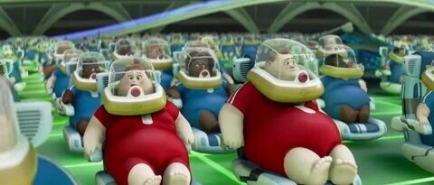

# Наблюдение за здоровьем с помощью ИИ — презентация

Перенесено из PowerPoint (`presentation.pptx`, оригинал — в истории git). Картинки — в `slajdy-img/`.

## Слайд 1

Наблюдение за здоровьемс помощью ИИ

ИИ и ИБ · 6 класс · Урок 2

Модуль: Применение искусственного интеллекта

## Слайд 2

Правило урока

ПРОГНОЗ  →  ПРОВЕРКА  →  ВОЗВРАТ

Делаем прогноз → проверяем фактами → возвращаемся и смотрим, изменилось ли мнение

На прошлом уроке: ИИ — не хрустальный шар, а машина для поиска закономерностей

## Слайд 3

Три утверждения. Ваш прогноз?

1. Чем больше умные часы знают о твоём теле (пульс, шаги, сон),    тем здоровее ты автоматически становишься.

2. Фитнес-браслеты и нейросети никогда не ошибаются    и показывают только чистую правду.

3. Тренер-нейросеть в смартфоне лучше подготовит    тебя к соревнованиям, чем живой человек.

Согласен · Не согласен · 50 на 50

## Слайд 4

Блок 1. Данные и здоровье

🖼 ВАЛЛ-И (WALL-E)

Люди в летающих креслах

Перед каждым — экран с данными о здоровье

Корпорация BnL собирает всё

Но они не здоровы и не двигаются

Данные есть — здоровья нет

Данные — это топливо.Кому принадлежит ваш пульс?

## Слайд 5

Когда данные помогают, а когда — вредят?

✅ ПОМОГАЕТ

Врач видит тренд

Человек получает обратную связь

Человек действует

Данные ведут к решению

❌ ВРЕДИТ

Утечка приватных данных

Слепая вера экрану

Человек игнорирует самочувствие

Данные без действия = мусор

Объём данных ≠ здоровье. Данные — топливо для чужих моделей.

## Слайд 6

Блок 2. Сбой ИИ-устройства

Оптический пульсометр

Зелёные светодиоды светят через кожу

Гемоглобин поглощает зелёный свет

Фотодетектор ловит отражённый свет

Алгоритм считает пульс

Татуировка блокирует датчик!

🖼 [ Схема: зелёный свет →кожа → фотодетектор ]

Шаги: ложные срабатывания

Еда рукой = «шаги»

Жестикуляция = «шаги»

Тряска в автобусе = «шаги»

Акселерометр + гироскоп

Не понимают контекст

## Слайд 7

Калории: цифрам верить нельзя

Погрешность 15–25% и выше

Считает по пульсу, движению, профилю (рост, вес, возраст)

Не учитывает мышечную массу, обмен веществ

Стэнфорд: трекеры точнее меряют пульс, чем расход энергии

Никаких диет по браслету!

Чем выше процент жира — тем больше погрешность

## Слайд 8

98,91% — что это на самом деле?

Разработка Иннополиса + ЛЭТИ

98,91% — точность распознавания 30+ видов ДВИЖЕНИЙ

В контролируемых условиях

На устройстве без интернета (без облака)

Это НЕ «99% вашего здоровья»

Это «99% вероятности, что алгоритм понял: вы плывёте, а не бежите»

## Слайд 9

Куда уходят ваши данные?

Датчик на руке→ Приложение на телефоне→ Сервер компании→ Аналитики, разработчики, сторонние сервисы

Кто видит ваш пульс, сон и геолокацию?

Приватность — это важно

## Слайд 10

Компьютерный блок: Симулятор датчика

Задание:

Откройте файл simulator.html на ноутбуке

Двигайте ползунки: «Движение руки» и «Плотность рисунка»

Найдите значения, при которых датчик «теряет» пульс

Подумайте: значит ли это, что гаджет всегда показывает правду?

При каких настройках датчик сломался?

## Слайд 11

Блок 3. Кейс «Боль 10/10»

На тренировке заболела нога. Боль 10 из 10. Вы внесли это в приложение-тренер.

🤖 ИИ-ТРЕНЕР

Зафиксировал «боль 10/10»

Проигнорировал контекст

Выдал шаблон по расписанию

На следующий день — тяжёлая тренировка

Не сопоставил боль с риском травмы

👨‍🏫 ЖИВОЙ ТРЕНЕР

Посмотрел на ваше лицо

Остановил тренировку

Спросил: «Как именно болит?»

Отправил к врачу

Видит контекст и берёт ответственность

ИИ — помощник, не замена. Ответственность — на человеке.

## Слайд 12

🖼 «Зверопой»

Буллит наставляет Моисея.Видит его состояние и страх —а не сухие цифры на экране.Тренер видит то, что датчикникогда не зафиксирует:страх, усталость, боль, контекст.

## Слайд 13

ИИ в медицине

FDA зарегистрировала 1016 ИИ/ML-медицинских устройств

ИИ анализирует МРТ, рентген, ЭКГ, медкарты

70% будущих врачей: ИИ не заменит врача

Ответственность за ошибку — на враче, не на ИИ

ИИ — помощник, не замена

## Слайд 14

Возвращаемся к прогнозам

1. Данные — это не здоровье, а информация, которая может как помочь, так и навредить

2. Гаджеты ошибаются — их датчики ограничены физикой, а данные уходят на чужие серверы

3. ИИ — крутой помощник для статистики, но капитаном всегда остаётся живой человек

Изменилось ли ваше мнение?

## Слайд 15

Следующий урок:

ИИ и психология:кто читает ваши эмоции?

ИИ собирает данные не только о теле, но и о мыслях и чувствах
