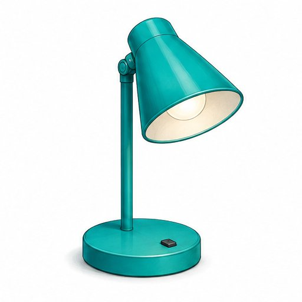
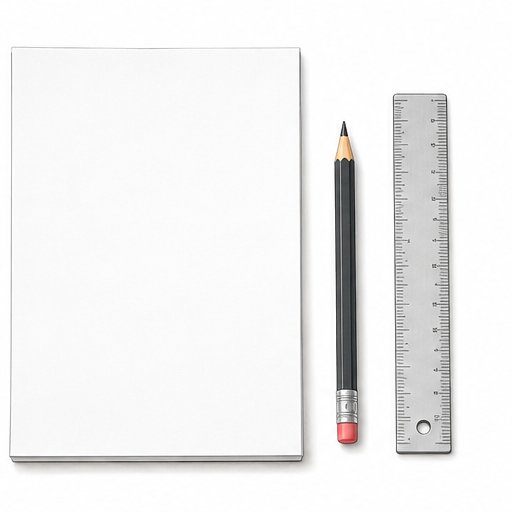
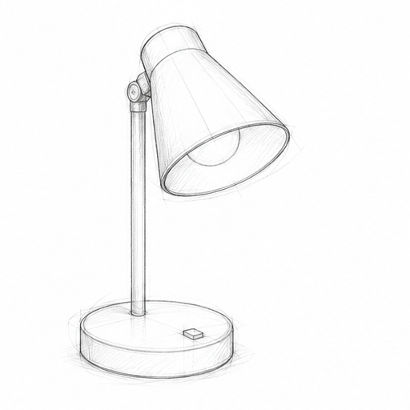
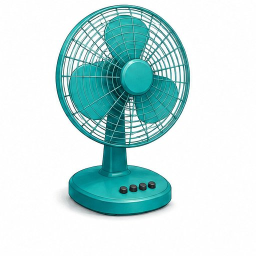
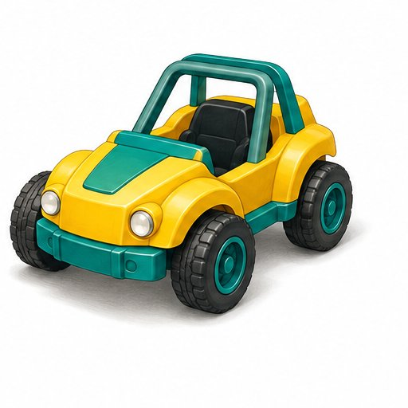
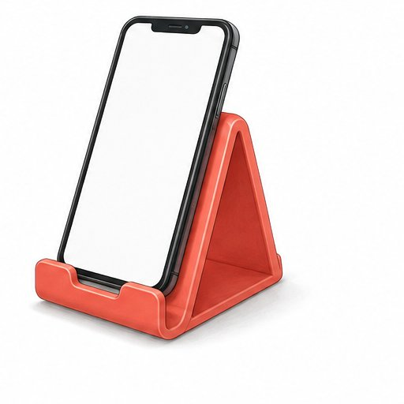

# Практическая работа «Выполнение эскиза модели технического устройства»

Перевод презентации PowerPoint в текст: слайд за слайдом, картинки — в `media/`.

## 1. Практическая работа

- Выполнение эскиза
- модели технического
- устройства
- Технология • 6 класс

## 2. Цель урока и чему научимся

- Создадим понятный эскиз
- своей модели
- Выделять основные детали
- Из каких частей состоит устройство?
- Передавать форму
- Рисовать от руки, сохраняя пропорции
- Объяснять конструкцию
- Добавлять подписи и размеры
- Проверять свою работу
- Понятна ли модель другому человеку?

## 3. Техника безопасности

- Порядок на столе
- Лишние вещи убери, проход оставь свободным
- Инструменты по назначению
- Не размахивай ими и не передавай броском
- Удобная посадка
- Сиди прямо, не наклоняйся низко над листом

## 4. Эскиз, рисунок и чертёж

- Художественный
- рисунок
- Эскиз
- Чертёж
- Передаёт внешний вид,
- цвет и настроение
- Объясняет форму
- и устройство предмета
- Точно задаёт форму
- и размеры для изготовления
- Свободная техника
- и выразительность
- От руки, без точного масштаба
- Пропорции сохраняем
- По правилам, в масштабе
- С помощью инструментов
- Эскиз помогает понять, как устроена будущая модель

## 5. Настольная лампа: основные детали

- Плафон
- Направляет свет
- Стойка
- Держит плафон
- Основание
- Придаёт устойчивость
- Выключатель
- Включает свет

## 6. Алгоритм выполнения эскиза

- Идея
- →
- Общая форма
- →
- Основные детали
- →
- Уточнение
- →
- Подписи
- →
- Размеры
- →
- Проверка
- плафон
- основание
- Лёгкий общий контур
- Форма и пропорции деталей
- Уточнённый эскиз с подписями

## 7. Правила хорошего эскиза

- Крупное изображение
- Оставь место для подписей и размеров
- Сначала лёгкие линии
- Уточни форму и выдели основной контур
- Понятные обозначения
- Выноски и размерные линии не путай с контуром

## 8. Практическая работа

- Выбери устройство и выполни его эскиз на листе А4
- Вентилятор
- Модель автомобиля
- Подставка для телефона
- Можно выбрать лампу, фонарик, робота или собственную идею

## 9. Требования к готовой работе

- Название и назначение
- Что это? Для чего нужно?
- Основные детали
- Не менее 3 подписей с выносками
- Размеры модели
- Не менее 2 размеров в миллиметрах
- Пример: вид спереди
- 300
- 180
- Все размеры в мм
- Числа условные: для учебной модели

## 10. Критерии оценивания: 10 баллов

- Форма и пропорции понятны
- 0 / 1 / 2
- Основные детали показаны
- 0 / 1 / 2
- Есть не менее 3 подписей
- 0 / 1 / 2
- Есть не менее 2 размеров в мм
- 0 / 1 / 2
- Работа аккуратна и читаема
- 0 / 1 / 2
- 2 — выполнено     1 — частично     0 — не выполнено

## 11. Дополнительное задание «Улучши конструкцию»

- Как сделать модель удобнее?
- ?
- Выбери одну проблему
- Лампа неустойчива? Свет трудно направить?
- +
- Покажи изменение на эскизе
- Добавь деталь и подпиши её пользу
- Возможные решения
- Более широкое основание
- Поворотный плафон
- Держатель для карандаша
- «Я добавил(а) …, чтобы …»

## 12. Рефлексия и самооценка

- Мой результат: ___ / 10
- Сегодня у меня получилось…
- Назови конкретный этап работы
- Я ещё потренируюсь…
- Выбери один навык для следующей работы
- Покажи соседу: понятна ли конструкция без твоего объяснения?
