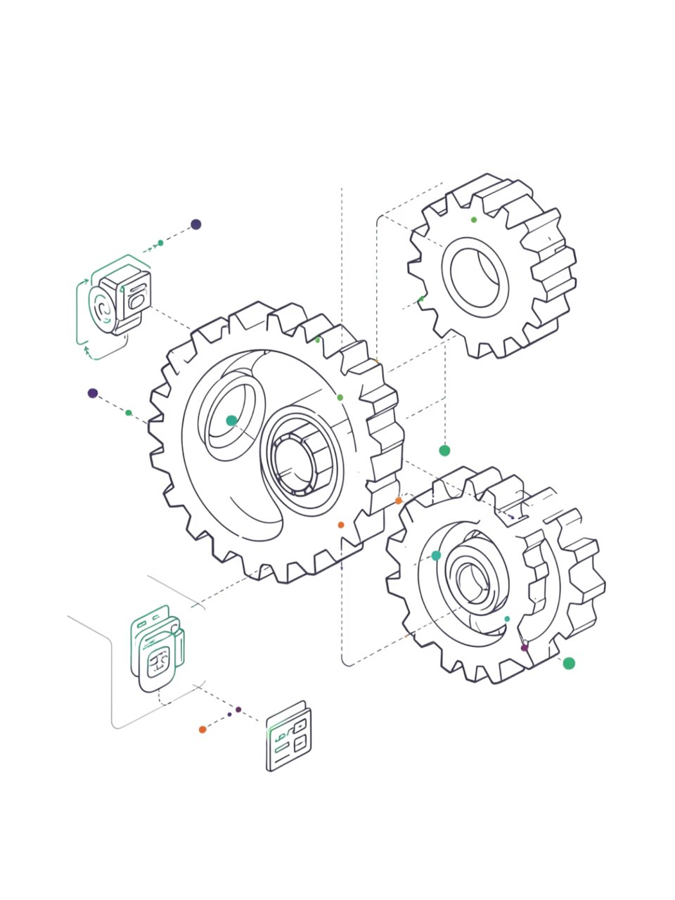
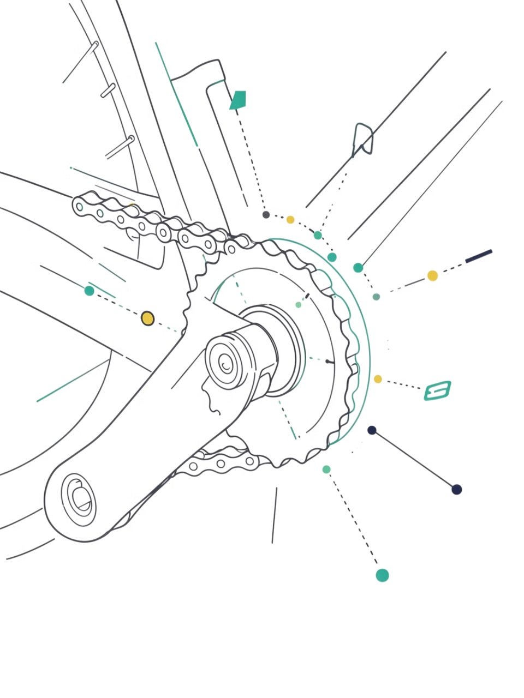
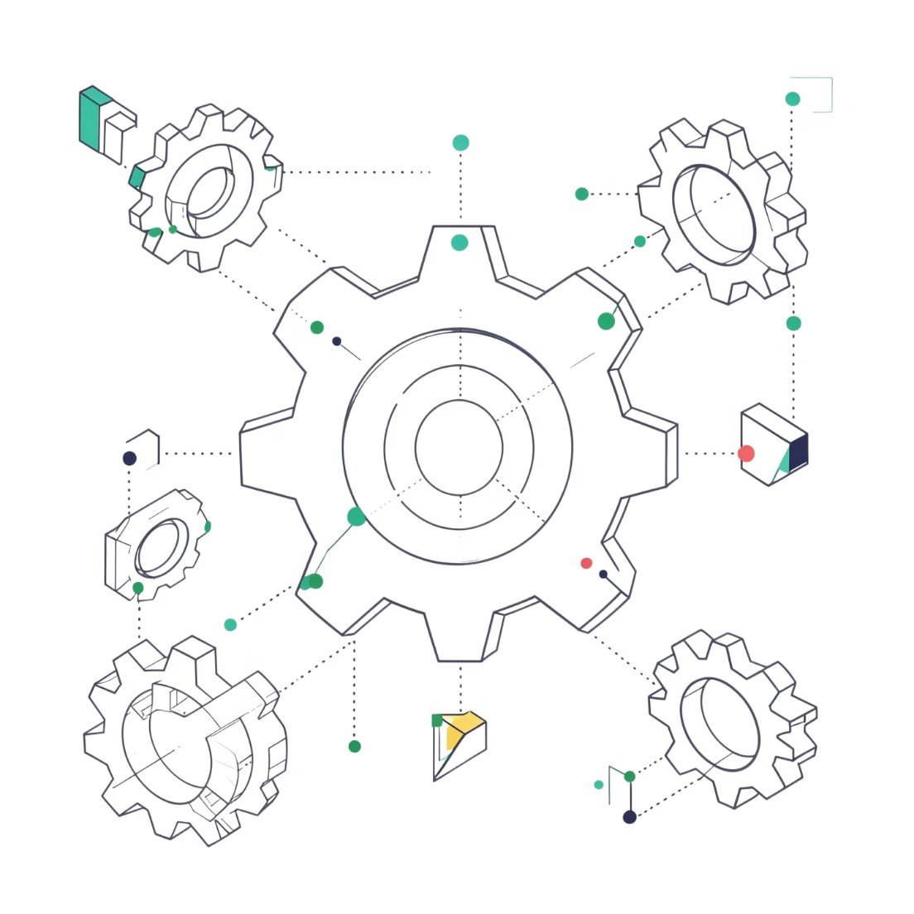
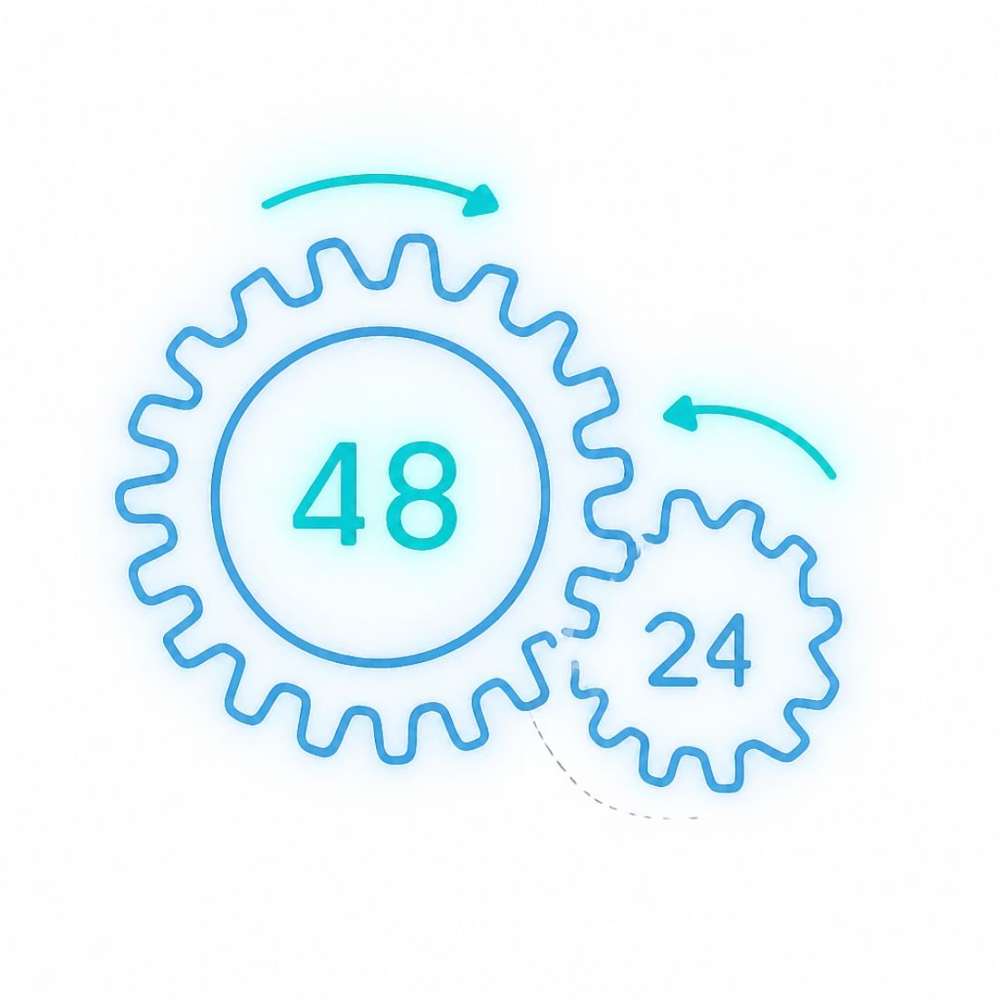
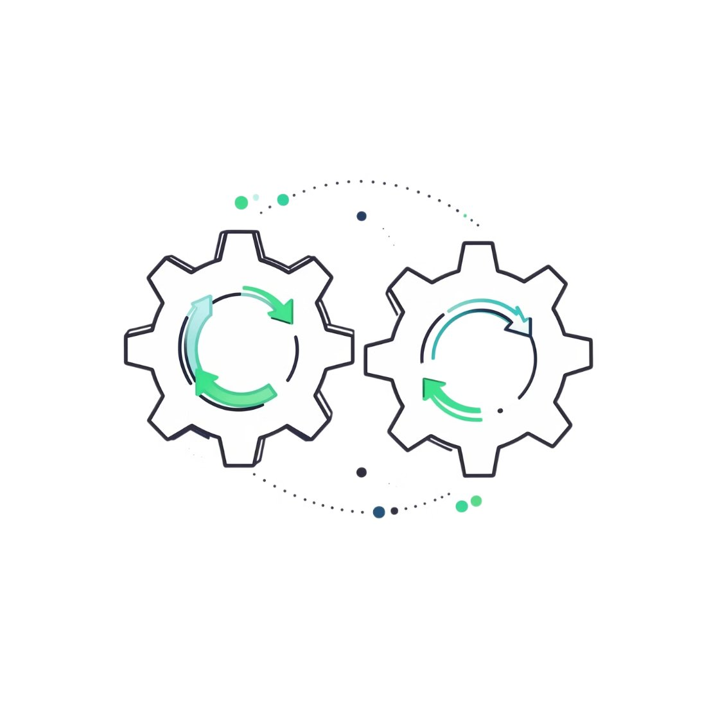
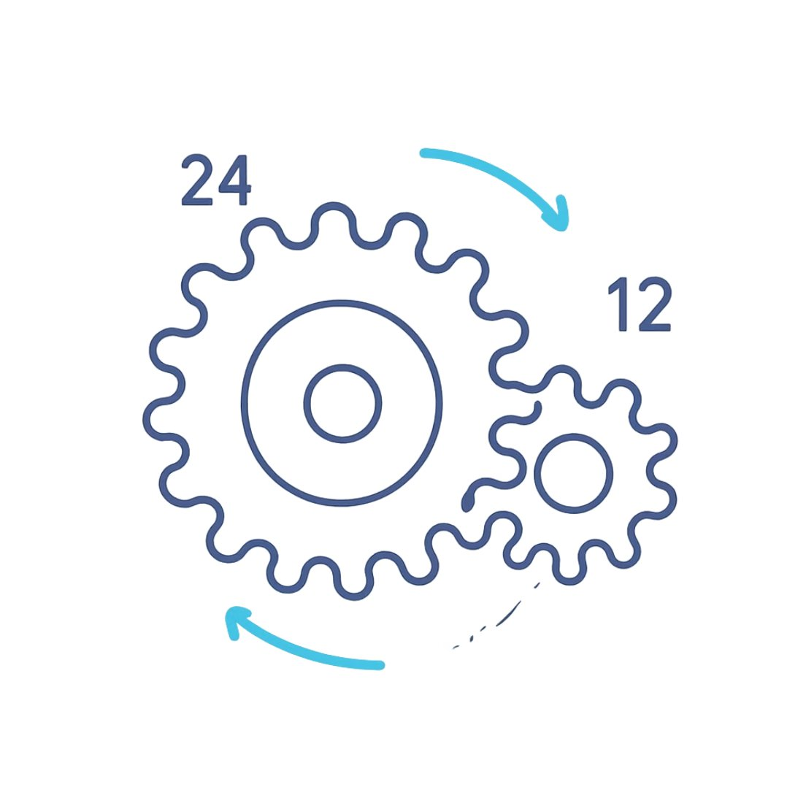
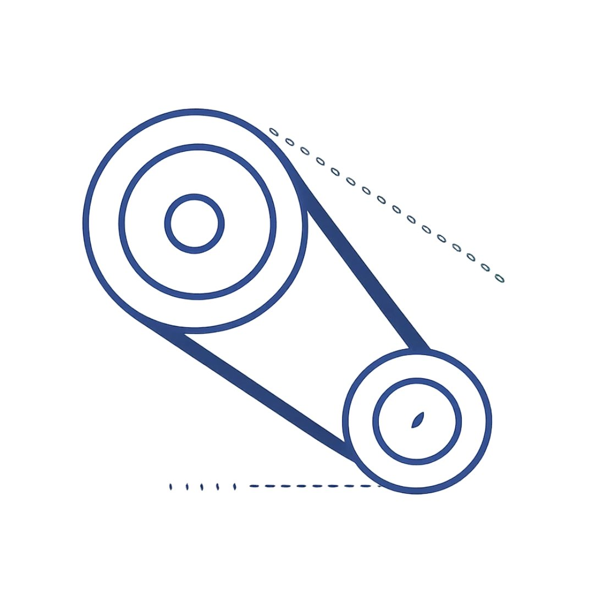
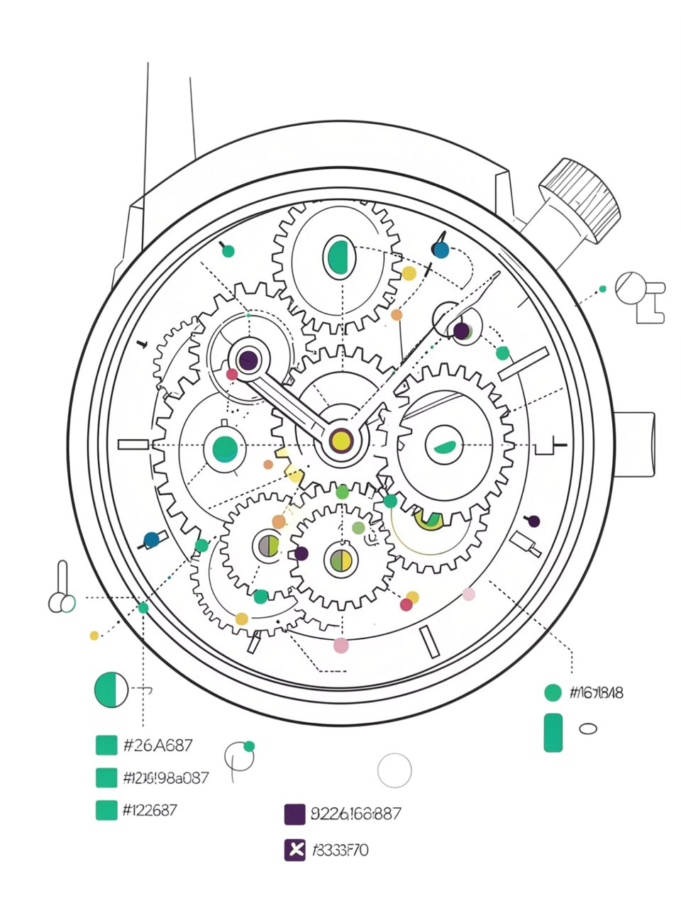

# Чтение кинематических схем машин и механизмов

Перевод презентации PowerPoint в текст: слайд за слайдом, картинки — в `media/`.

## 1. Чтение кинематических схем машин и механизмов

- Практическая работа • 6 класс • Технология

## 2. Где передаётся движение?

- 🚲 Велосипед
- Цепная передача от педалей к заднему колесу
- 🧵 Швейная машина
- Ремённая передача маховика и ремни
- ⏱️ Часы
- Зубчатая передача внутри механизма

## 3. Условные обозначения передач

- Зубчатая передача
- Две соприкасающиеся окружности с зубцами
- Цепная передача
- Две окружности, соединённые пунктирной линией
- Ремённая передача
- Две окружности, соединённые сплошной линией

## 4. Главное правило кинематики

- n₁ · z₁ = n₂ · z₂
- Основная формула кинематической передачи
- Во сколько раз зубьев больше — во столько же раз оборотов меньше.
- Пример: шестерня с 48 зубьями и шестерня с 24 зубьями → соотношение 2:1 → меньшая крутится вдвое быстрее

## 5. Правило направлений вращения

- Зубчатое зацепление
- Каждый контакт меняет направление
- Ремень и цепь
- Направление сохраняется
- Чётное число зацеплений
- Крайние колёса вращаются одинаково
- Зубчатое зацепление — каждый контакт меняет направление. Ремень и цепь — направление сохраняется. Чётное число зацеплений → крайние колёса крутятся в одну сторону.

## 6. Прогнозируем!

- Большая шестерня
- 48 зубьев, вращается по часовой стрелке
- Маленькая шестерня
- 24 зуба, сцеплена с большой
- Ваш прогноз?
- Куда крутится маленькая? Во сколько раз быстрее?

## 7. ЗАДАЧА 1

- Зубчатая передача
- Дано
- Ведущая шестерня: z₁ = 24 зуба, n₁ = 15 об/мин
- Ведомая шестерня: z₂ = 12 зубьев
- Найти
- n₂ = ?
- Решение
- n₁ · z₁ = n₂ · z₂
- 15 · 24 = n₂ · 12
- n₂ = 30 об/мин (отношение 2:1)

## 8. ЗАДАЧА 2

- Ремённая передача
- Дано
- Ведущая: n₁ = 30 об/мин, z₁ = ?
- Ведомая: n₂ = 15 об/мин, z₂ = 48 зубьев
- Найти: z₁ = ?
- n₁ · z₁ = n₂ · z₂
- 30 · z₁ = 15 · 48
- z₁ = 24 зуба
- Ремень сохраняет направление вращения — ведомый шкив крутится в ту же сторону

## 9. ЗАДАЧА 3

- Цепочка передач
- Шестерня 1
- 12 зубьев · 24 об/мин · ↻
- Шестерня 2
- 24 зуба · 12 об/мин · ↺
- Шестерня 3
- 12 зубьев · 24 об/мин · ↻
- Вывод
- Промежуточные меняют направление, не скорость
- Шестерня 1
- 12 зубьев · 24 об/мин · ↻ по часовой
- Шестерня 2
- 24 зуба · 12 об/мин · ↺ против часовой
- Шестерня 3
- 12 зубьев · 24 об/мин · ↻ по часовой
- Вывод: промежуточные колёса меняют только направление, но не скорость крайних шестерён.

## 10. Итог урока и домашнее задание

- Три ключевых вопроса
- От какого колеса передаётся движение? В какую сторону крутится ведомое? Во сколько раз быстрее?
- Домашнее задание
- Найти передачу в реальном механизме: велосипед, швейная машина, мясорубка, дрель, миксер, точило, лебёдка или часы.

