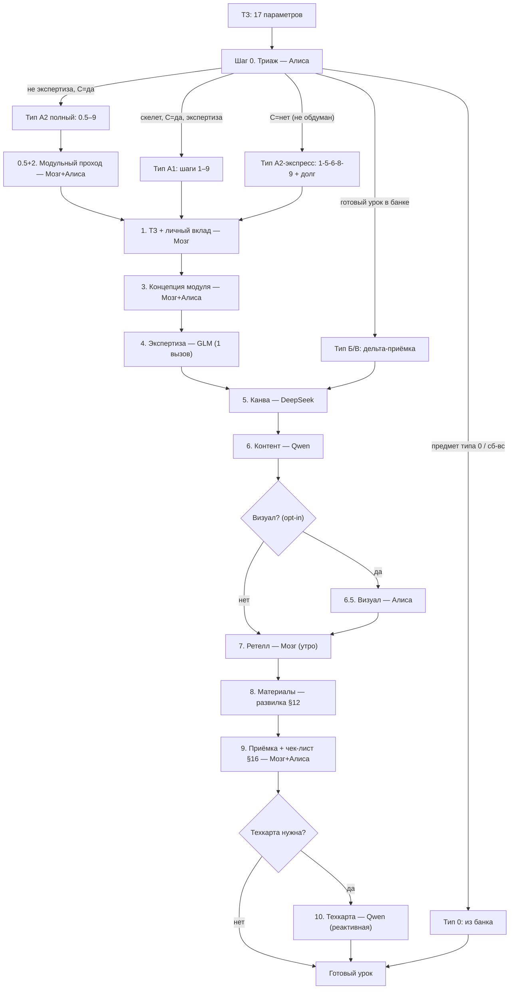

# Алгоритм разработки урока (v4)

**Основание:** v8.4 (финальная). Шаблон v3 переработан под операционное исполнение: Алиса получает ТЗ и ведёт урок по этапам в диалоге.

**Суть:** Мозг — автор и дирижёр. Алиса — оркестратор: ведёт по этапам, проверяет факт и структуру против промта (не методику), готовит промпты для внешних ИИ, делает поиск, визуал и простые приложения. Методику оценивает только GLM (свежий чат, один вызов). Канву пишет DeepSeek, контент — Qwen. «Своим» урок становится на шагах 7 (ретелл) и 9 (приёмка).

**Шапка-контекст:** 8–10 строк первым сообщением в каждый чат с внешним ИИ (DeepSeek, Qwen, GLM, Claude). Алиса готовит и передаёт.

---

## Входные параметры (ТЗ)

| № | Параметр | Значения | На что влияет |
|---|---|---|---|
| 1 | Предмет | — | Контекст |
| 2 | Параллель (класс) | — | Возраст, сложность |
| 3 | Возраст | — | — |
| 4 | Число учеников | — | Вход проверки: проценты, не количества (ПДн) |
| 5 | Успешность группы | 2–5 | Углубление / упрощение |
| 6 | Управляемость группы | 2–5 | Формат, длина блоков |
| 7 | Тема | — | Определяет тип урока |
| 8 | Тип урока | производный (выводит Алиса на шаге 0) | — |
| 9 | Наполнение | открытый список; содержит «практика без компьютера / с инструментом» | Артефакты, ТБ-логика |
| 10 | Комментарий | — | — |
| 11 | День проведения | пн–сб | Вечер производства (всегда накануне; пн → ВС-П), потолок |
| 12 | Статус предмета (A) | новый / идущий / в зоне экспертизы (≥3 модуля) | Полный А2 / экспресс |
| 13 | Модуль и состояние (B) | имя; скелет есть/нет; флаг банка | Б против А; график аудита |
| 14 | Мышление по модулю (C) | да / нет | Полный А2 / экспресс |
| 15 | Место урока в модуле (D) | первый / середина / завершающий | Первый — без аудита; завершающий — обобщение |
| 16 | Требуемые артефакты | печатные / презентация / визуал / приложение (нет-простое-среднее-сложное) | Лёгкий/тяжёлый А1; развилка §12 |
| 17 | Состояние исполнителя | норма / после жёлтой / после красной / тяжёлый день | Бюджет вечера, §18 |

**Позиция в очереди** — из счётчика вечера, не из заявки.

---

## Шаг 0. Триаж — Алиса определяет тип

Алиса читает четыре факта из ТЗ (параметры 12–15) и выводит тип:

| Условие | Тип | Шаги |
|---|---|---|
| Предмет типа 0 (инф. 7–9, повторы нач. школы) или сб/вс | **0** | — |
| B = готовый урок, флаг `готово` | **Б/В** | дельта-приёмка |
| B = готовый урок, флаг `понижено`/`аварийный`/`неполный` | **Б/В** | пересборка + дельта |
| B = скелет модуля, C = да | **А1** (лёгкий/тяжёлый по артефактам) | 1–9, шаг 5 укорочен: канва из скелета |
| A = в зоне экспертизы, B = пусто, C = да | **А1** | 1–9 |
| C = нет (модуль не обдуман), любая A | **А2-экспресс** | 1→5→6→8→9 + долг |
| A ≠ «в зоне экспертизы», B = пусто, C = да | **А2 полный** | 0.5–9 |

Правила вывода:

- **Скелет модуля не делает урок типом Б.** Скелет экономит часть шага 5, урок остаётся А и проходит 7 и 9 полностью.
- **П не вводится никогда и никем.** Его присваивает только аукцион 22:00.
- **Аудит не входит в цикл текущего урока:** в ВС-2 проверяются материалы уже прошедших уроков. Первый урок модуля идёт без аудита; при экспрессе печатный fallback обязателен.
- **Два А2 в один вечер невозможно** — следствие арифметики очков, не правило.

**Валидатор (Алиса проверяет сразу после вывода):**

| Несоответствие | Пересчёт |
|---|---|
| Б/В при пустом банке | → А |
| Полный А2 при C = нет | → экспресс + долг |
| Полный А2 в ВС-П | → экспресс (нет мышления) |
| Второй А2 в вечер | → перенос в пол / остаток ёмкости |
| «П» без типового печатного листа модуля | → fallback |
| Очки заявки > потолка вечера | → §1.8 (жертвоприношение сверху вниз) |
| Подготовка не в канун | → отказ (правило 1) |

---

## Распределение ролей

| ИИ-инструмент | Роль | Что делает / не делает |
|---|---|---|
| **Алиса** | Оркестратор, поиск, проверка | Веб-поиск, дифф факт/структура против промта, фактчек ИИ+труд, промпты правок, простые приложения, визуал. **Не канва, не контент** |
| **DeepSeek** | Канва, скелеты | Структура, логика урока, скелет модуля. Резерв при деградации |
| **Qwen** | Контент, материалы | Контент, печатные, презентации по шаблону, техкарты. Тезисность слайдов — в промпте |
| **GLM** | Экспертиза, аудит | Свежий чат, один вызов. Методика — только здесь. Средние приложения без рассуждений |
| **Claude** | Сложные приложения | Сразу, через API-агрегатор (рубли, без VPN). Лестница fallback |
| **Мозг** | Автор, дирижёр | ТЗ, ретелл, приёмка. На входе и на выходе |

**Удалены:** GigaChat, Cherry Studio. **Резерв:** Gemini (нестабильный).

**Деградация:** Алиса → ручной поиск · DeepSeek → Qwen/GLM · Qwen → DeepSeek/GLM · GLM → «аудитор ≠ автор» · Claude → путь N. Промпты модель-агностичны.

---

## Стоимость типов

| Тип | Шаги | Стена (мин) | Очки |
|---|---|---|---|
| **0** | — (из банка) | 0 | 0 |
| **В** | скелет → пересборка Qwen → 8–9 дельта | 20–30 | 1 |
| **Б** | скелет → 5 → 6 → 7 → 8–9 дельта | 35–45 | 1 |
| **П** | скелет канвы → 8 → дельта 5 мин. Без 3, 4, аудита. Только из аукциона, нужен типовой печатный лист. Флаг `понижено` | 15 | 0,5 |
| **А1 лёгкий** | 1–9 (без визуала и приложения) | 75–95 | 2 |
| **А1 тяжёлый** | 1–9 | 102–128 | 3–4 |
| **А2 экспресс** | 1→5→6→8→9. Без 0.5/2/3/4/аудита/визуала. Печатный fallback обязателен. Флаг `неполный`, долг | 85–110 | 3 |
| **А2 полный** | 0.5–9 с ВС-2-мышлением | как тяжёлый (+30–45 в ВС-2) | 4 |

**Потолок: не более одного А2 (любого) на вечер.**

---

## Этапы разработки

| Шаг | Что делаем | Кто исполняет | Что делает Алиса | Слот | Лимит | Типы |
|---|---|---|---|---|---|---|
| 0.5+2 | Модульный проход: цели, 3 заблуждения, где я неправ + карта идей | Мозг+Алиса | Парный поиск, суммаризация, карта идей | ВС-2 | 30–45 мин/модуль | А2 полный |
| 1 | ТЗ + поле личного вклада; для 10/11 — из карты пробелов | Мозг | Фасилитация: задать вопросы для формирования ТЗ | ВС-2 / вечер (экспресс) | — | А1, А2 |
| 3 | Концепция модуля; заблуждения 0.5 в промте | Мозг+Алиса | Парная работа, проверка фактов концепции | ВС-2 | 1 цикл (КТ-1) | А2 полный |
| 4 | Экспертиза полного контекста | GLM | Готовит промпт для GLM (свежий чат, одним сообщением, режим Max). Принимает результат. **Методику не оценивает** — это зона GLM | ВС-2 | 1 цикл ≤15 мин; 2-й = методическая ошибка | А2 полный |
| 5 | Скелет канвы модуля → канва урока из скелета | DeepSeek | Готовит промпт для DeepSeek (+ шапка-контекст). Принимает канву. **Проверяет факт/структуру, не методику** | ВС-2 → вечер | скелет ≤10 мин; канва ≤5 мин | А1, А2, Б, В, П |
| 6 | Контент; дельта против канвы + фактчек | Qwen | Готовит промпт для Qwen (+ шапка-контекст, + личный вклад из ТЗ). Принимает контент. **Дельта-проверка: контент vs канва + фактчек** | вечер | ≤3 цикла / ≤15 мин | А1, А2, Б |
| 6.5 | Визуал, opt-in | Алиса | Генерация по префиксу стиля → файл в `assets`. Текста на картинках нет (HTML-подписи). Запрещено: интерфейсы реальных сервисов, реальные люди, схемы с фактическими данными | вечер | 5–8 / 12–18 мин, ≤5 | А1 (opt-in), А2 полный (opt-in) |
| 7 | Ретелл | Мозг | Фасилитация: Мозг рассказывает канву без листа 2 мин. Провал → +1 очко или fallback. Пассивно в тяжёлый день / после жёлтой; после красной отменён | утро дня урока | 5–10 мин | А1, А2, Б (П — пассивно) |
| 8 | Материалы: печатные + презентация ± приложение | Развилка (§12) | Печатные → промпт для Qwen. Презентация → промпт для Qwen по шаблону. Приложение: простое — Алиса; среднее — промпт для GLM/DeepSeek; сложное — промпт для Claude. **Печатный fallback обязателен** | вечер | 20 / 35 мин | А1, А2, Б, В, П |
| 9 | Приёмка + чек-лист §16 | Мозг+Алиса | **Гоняет чек-лист §16**: визуал, функционал, окружение, контент, факты, ТБ, ФГОС, ПДн, замыкание, присвоение. Печатный fallback физически в пакете | вечер | 25–30; Б — дельты; П — 5 мин | Все, кроме 0 |
| 10 | Техкарта реактивная | Qwen | Готовит промпт (шаблон + образец, свежий чат). Источник: канва + заметка. ФГОС-номера из первоисточника вручную | по требованию | не из бюджета | Все (0 — плановая по КТП раз в четверть) |

**Опция Мозга (труд/ИБ, первые модули, цена ошибки выше):** +10 мин GLM-чека контента первого урока модуля. 112–138 ≤ 150, в вечер влезает. Не требование, выбор.

---

## Развилка шага 8 (§12)

| Артефакт | Кто | Лимит | Примечание |
|---|---|---|---|
| Печатные | Qwen | — | Всегда |
| Презентация | Qwen по шаблону | 2 круга, потом Claude | «Тезис, не абзац» — в промпте |
| Приложение простое | Алиса / Qwen | — | Работающее простое лучше сломанного сложного |
| Приложение среднее | GLM (без рассуждений) / DeepSeek | — | — |
| Приложение сложное | **Claude сразу** (API-агрегатор) | скриншот-QA | Лестница fallback. Тупик → fallback из канвы. Критерий равного качества — объём кода |
| Печатный fallback | Qwen | — | Обязателен в пакете каждого урока с приложением. В П, аварийном, А2-экспрессе — единственный материал |

**В П, аварийном и А2-экспрессе приложений нет — обязателен печатный вариант.**

---

## Чек-лист шага 9 (§16)

**Визуал:** переполнение, контраст, доска, 4:3 и 16:9, `@media print`, читаемость в ч/б.

**Функционал:** кнопки, F12, интерактивы, сброс.

**Окружение:** grep `http/https/CDN` = 0; ES2018 (без `?.`, `??`, `import/export`); двойной клик из папки (не предпросмотр); один файл без прав администратора; FAT32; MOTW «Разблокировать»; читается без `assets`; имена латиницей; первый экземпляр класса артефакта — прогон вне окна раздачи; печатный fallback физически в пакете.

**Контент:** канва, опечатки, возраст, заблуждения 0.5 отработаны, fallback жив и печатается, термины по полю ТЕРМИНЫ.

**Факты:** ИИ — Алиса фактчек; труд симметрично (материалы, инструмент, не только ТБ); ни одного сгенерированного скриншота интерфейса.

**ТБ. ФГОС** из первоисточника. **ПДн** не утекли (проценты, не количества).

**Замыкание:** заметка записана (со служебными строками: зона коридора, «вечер занял ~N мин»), флаг, раскладка/входящие, бэкап. **Присвоение:** ретелл пройден, «проведу ли с моими детьми». Находка-промпт → в библиотеку.

---

## Логика по группе (§14)

- **Усп. 5** → углубление, доп. задачи, олимпиадный уровень (DeepSeek в канве).
- **Усп. 2** → упрощение, больше аналогий, пошаговость, визуальные опоры (Qwen).
- **Упр. 5** → больше самостоятельной работы, меньше удержания.
- **Упр. 2** → короткие блоки, частая смена деятельности, интерактив из банка.

**Ручное (не ИИ):** ФГОС, ТБ труда, ПДн.
**Аудит:** бессрочно по каждому новому модулю незнакомого предмета. Аудитор ≠ автор.
**Последняя инстанция:** лимит исчерпан → упростить / «П» / полный А2 → экспресс с долгом / fallback / вручную. Шаг 7 не сокращается, шаг 9 не сокращается молча.

---

## Циклы и лимиты (§14)

| Шаг | Циклов | Лимит |
|---|---|---|
| 4 (GLM) | 1 | ≤15 мин; 2-й = методическая ошибка |
| 5 (DeepSeek) | ≤2 | ≤10 мин |
| 6 (Qwen) | ≤3 | ≤15 мин |
| 9 → 8 (возврат) | ≤3 | ≤20 мин |

---

## Правила маршрутизации

- **Алиса** — поиск, дифф факт/структура, фактчек ИИ+труд, визуал, простые приложения, промпты правок. **Не канва, не контент.** Оркестрирует весь поток: готовит промпты для внешних ИИ, принимает результаты, проверяет, передаёт дальше.
- **GLM** — независимый эксперт, один вызов, свежий чат. Не участвует нигде кроме шага 4 (и аудита). Подавать материал одним сообщением.
- **DeepSeek** — канва и скелеты. Не контент.
- **Qwen** — контент, печатные, презентации по шаблону, техкарты. Тезисность слайдов в промпте. Свежий чат для техкарты.
- **Claude** — сложные приложения, сразу, через API-агрегатор (рубли, без VPN).
- **Мозг** — на входе (ТЗ) и выходе (ретелл, приёмка). Без шагов 1, 7, 9 — слепая генерация.

---

## Порядок жертвоприношения (§1.8)

При превышении бюджета вечера — сверху вниз, до П и `сорвался`:

Визуал → мини-приложение (fallback из канвы) → презентация (тезисный текст) → понижение до П → полный А2 в А2-экспресс с долгом → лишний урок целиком в банк / аварийный пол.

Провал утреннего ретелла = +1 очко; нет очка = fallback без правок. Шаг 7 не жертвуется, шаг 9 не сокращается молча. Коридор — последнее средство.

---

## Схема потока (Mermaid)

---

## Циклы доработки

1. **Шаг 9 → Шаг 8:** если приёмка по чек-листу §16 нашла проблемы — материалы дорабатываются (Qwen/Claude/Алиса по развилке). ≤3 цикла / ≤20 мин.
2. **Шаг 6 → Qwen:** если дельта-проверка Алисы нашла несоответствия контента канве или фактчек провален. ≤3 цикла / ≤15 мин.
3. **Шаг 5 → DeepSeek:** если канва не прошла проверку факт/структура. ≤2 цикла / ≤10 мин.
4. **Шаг 4 → GLM:** второй цикл = методическая ошибка, не допускается.
